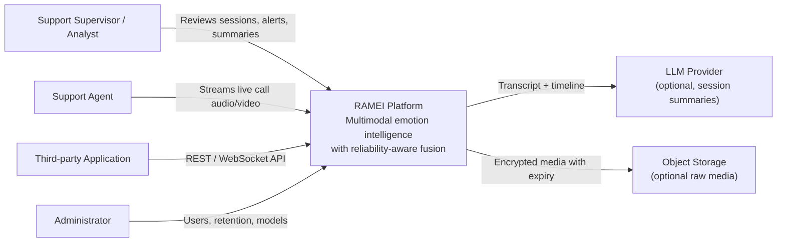
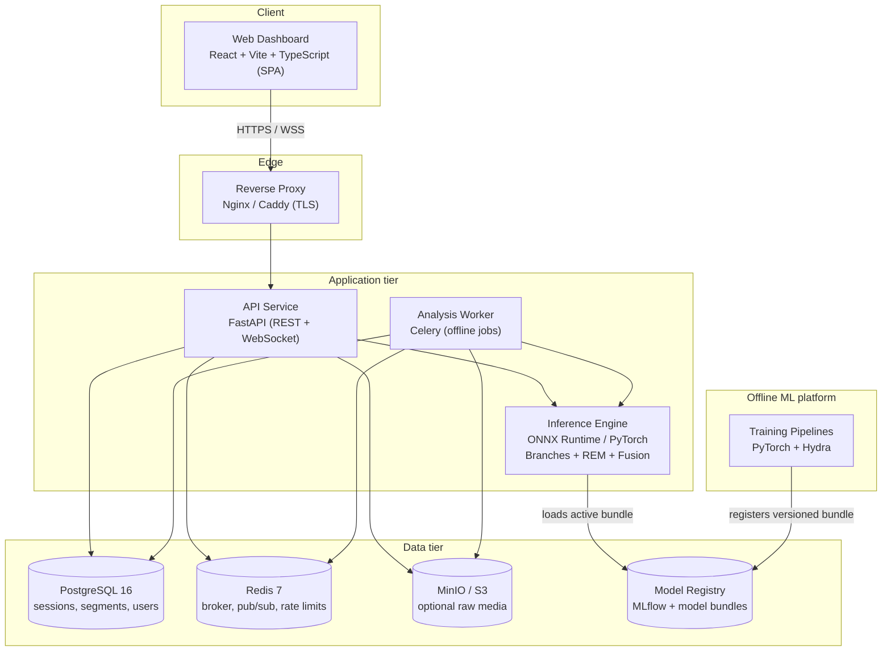
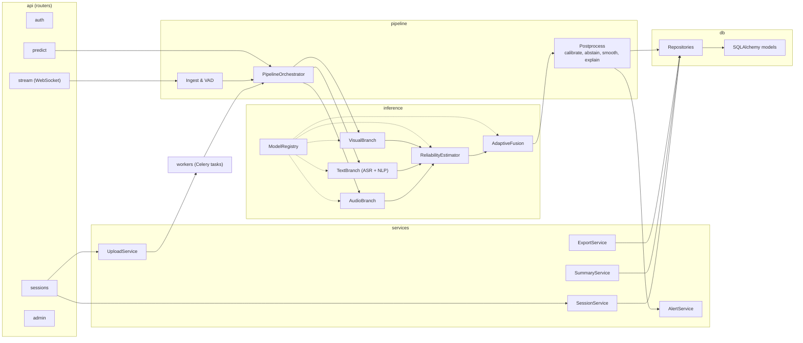
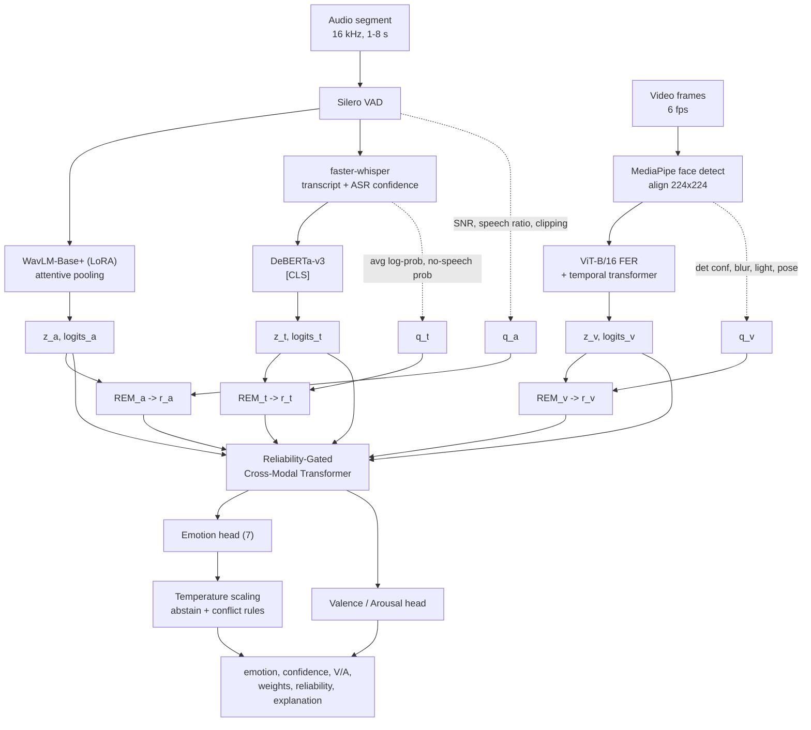
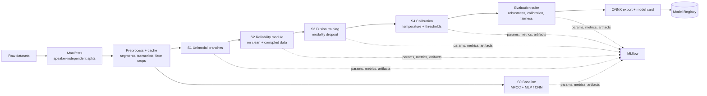
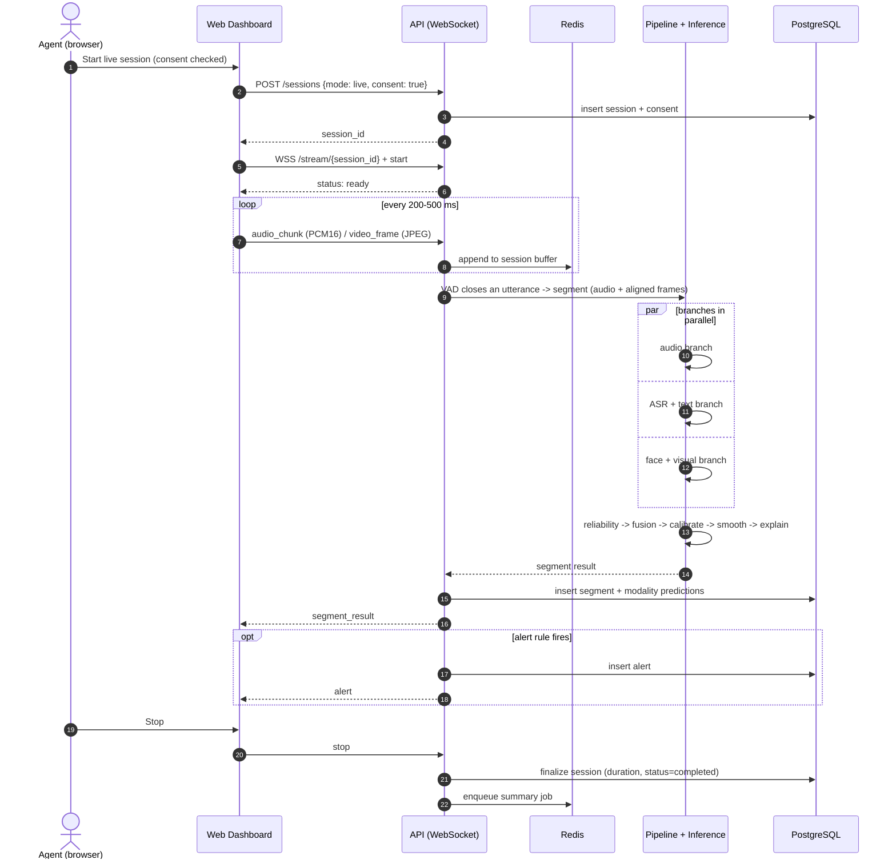
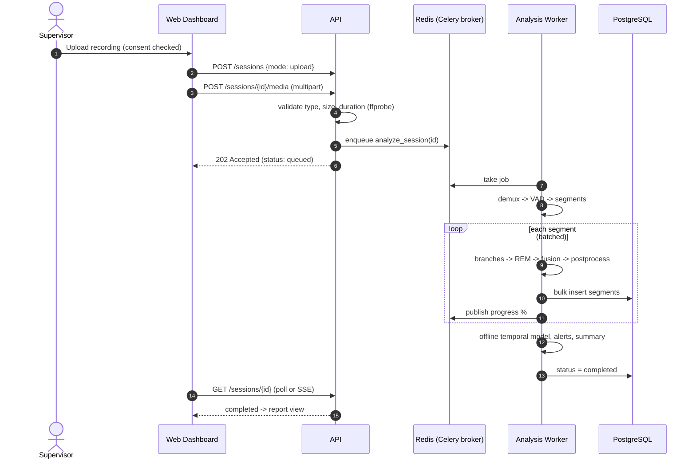
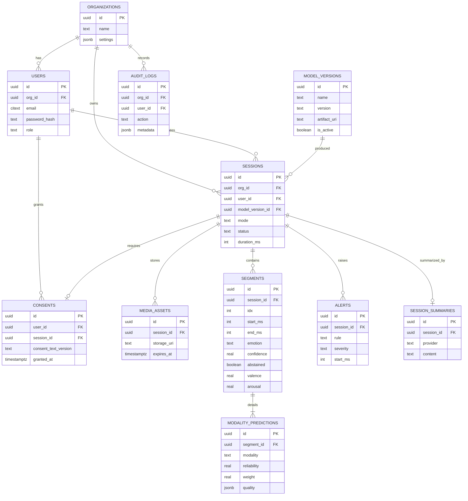
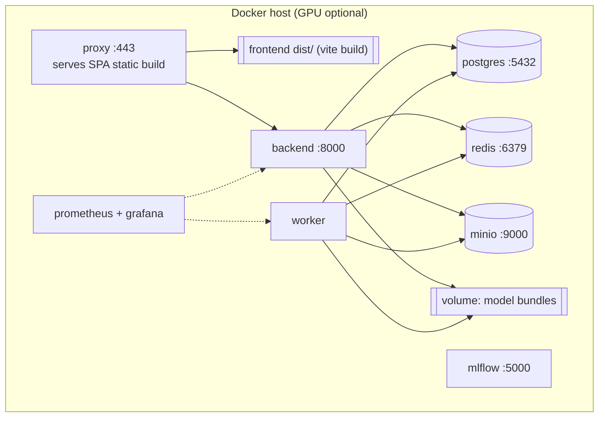
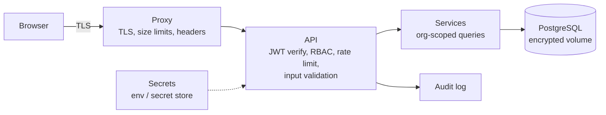

# System Architecture Document

## RAMEI — Reliability-Aware Adaptive Multimodal Emotion Intelligence

| Field | Value |
|---|---|
| Document ID | RAMEI-SAD-001 |
| Version | 1.0 |
| Status | Draft for review |
| Date | 2026-10-09 |
| Owner | Technical Lead — AD-INFOCOMM internship team |
| Inputs | [01-PRD.md](01-PRD.md), [02-TRD.md](02-TRD.md) |

---

## 1. Purpose

This document describes how RAMEI is structured and how its parts interact: system context,
containers, internal components, the ML architecture, runtime flows, data architecture,
deployment, and the cross-cutting concerns (reliability, scalability, security, observability).
Diagrams use the C4 model levels and Mermaid, which renders natively on GitHub.

## 2. Architectural principles

| # | Principle | How it shows up |
|---|---|---|
| P1 | **Reliability is a first-class signal** | Every modality emits a reliability score that drives fusion, abstention and explanations |
| P2 | **Graceful degradation** | Any subset of modalities works; failures in one branch never fail the request |
| P3 | **Separation of research and serving** | `ml/` trains and exports; `backend/` only loads versioned, exported bundles |
| P4 | **Stateless compute, stateful storage** | API and inference workers are horizontally scalable; state lives in PostgreSQL/Redis |
| P5 | **Contracts first** | OpenAPI + WebSocket message schemas are the single source of truth for the frontend |
| P6 | **Privacy by default** | Derived data only; raw media off unless enabled with expiry |
| P7 | **Reproducible by construction** | Configs, data manifests and model versions are tracked for every result |

## 3. System context (C4 Level 1)



## 4. Container view (C4 Level 2)



| Container | Responsibility | Scales by |
|---|---|---|
| Web Dashboard | Capture, visualize, review, administer; static SPA bundle | Static hosting / CDN |
| Reverse Proxy | TLS termination, routing, WebSocket upgrade, request size limits | Replicas |
| API Service | Auth, validation, session management, live streaming orchestration | Replicas (stateless) |
| Analysis Worker | Long-running file analysis jobs from the queue | Worker count |
| Inference Engine | In-process library used by API (live) and worker (offline); GPU-bound | GPU workers |
| PostgreSQL | System of record | Vertical + read replicas |
| Redis | Celery broker, live session state, pub/sub for progress, rate limiting | Single / sentinel |
| Object Storage | Optional encrypted raw media | Storage tier |
| Model Registry | Versioned model bundles with metrics and model cards | — |
| Training Pipelines | Offline research and training; never on the request path | — |

## 5. Component view — backend (C4 Level 3)



## 6. ML architecture

### 6.1 End-to-end model graph



### 6.2 Reliability-Gated Cross-Modal Transformer (RG-CMT)

```
Inputs per segment:  z_m (768-d), r_m ∈ [0,1], availability a_m ∈ {0,1}, m ∈ {audio, text, visual}

1. Token projection    x_m = LayerNorm(P_m · z_m) + e_m            (d = 256, e_m = modality embedding)
2. Sequence            X = [CLS, x_audio, x_text, x_visual]
3. Gated attention     score(i, k) = (q_i · k_k) / √d  +  β · log(r_k + ε)  +  (a_k == 0 ? −∞ : 0)
4. 2 layers × 4 heads, pre-norm, FFN 512, dropout 0.1
5. Heads on CLS        emotion logits (7), valence/arousal (2, tanh)
6. Explainability      w_m = mean attention mass of CLS → x_m over heads & layers
```

Why this design:
- The **log-reliability bias** lets low-reliability tokens be softly ignored without hard rules,
  while β is learned, so the model decides how strongly to trust the estimator.
- The **availability mask** gives exact handling of missing modalities.
- **Modality dropout + corruption** during training teaches the fusion to re-route trust.

### 6.3 Training-time architecture



### 6.4 Model bundle (contract between `ml/` and `backend/`)

```
ramei-rgcmt-<version>/
├── manifest.json          # version, created_at, git commit, data manifest hash, metrics
├── labels.json            # class index → emotion name
├── audio_branch.onnx
├── text_branch.onnx       # ASR model referenced by name/version in manifest
├── visual_branch.onnx
├── reliability.onnx
├── fusion.onnx
├── calibration.json       # temperature, τ_c, τ_r, conflict threshold
├── quality_stats.json     # normalization stats for quality features
└── MODEL_CARD.md
```

The backend validates `manifest.json` against its supported schema version at startup and
refuses to activate incompatible bundles.

## 7. Runtime flows

### 7.1 Live streaming session



### 7.2 Offline file analysis



### 7.3 Degradation behavior

| Condition | Detection | System behavior |
|---|---|---|
| Camera off / no face | No frames or face-present ratio < 0.2 | `a_v = 0`; fuse audio + text; UI shows "visual unavailable" |
| Heavy noise | Low SNR, low r_a | Audio weight drops; explanation states reason |
| Silence / no speech | VAD finds no speech | Visual-only prediction if face present; else no segment |
| ASR low confidence | Low avg log-prob | Text weight drops |
| All modalities unreliable | max r_m < τ_r | Abstain: `emotion = "uncertain"` |
| Branch runtime error | Exception in branch | Branch marked unavailable for that segment; request continues; error metric incremented |
| Inference backlog | Buffer > 2 s of media | Drop video frames first; `status: degraded` |
| LLM provider down | Timeout / error | Summary marked `pending_retry`; rest of report unaffected |

## 8. Data architecture

### 8.1 Entity–relationship model



Full DDL: [`database/schema/schema.sql`](../database/schema/schema.sql).

### 8.2 Data lifecycle

| Data | Where | Retention |
|---|---|---|
| Raw audio/video (live) | Memory / Redis buffer only | Discarded after segment processing |
| Raw uploaded file | Temp volume → optional MinIO | Deleted after analysis unless raw storage enabled (then `expires_at`) |
| Segment & modality results | PostgreSQL | Organization retention setting (default 90 days) |
| Summaries, alerts | PostgreSQL | Same as session |
| Audit logs | PostgreSQL | 1 year |
| Training data & caches | `ml/data/` (git-ignored) / DVC remote | Project lifetime |

## 9. Deployment architecture

### 9.1 Local / staging (Docker Compose)



### 9.2 Production (target)

| Concern | Approach |
|---|---|
| Orchestration | Kubernetes (or managed containers) with separate node pools for CPU (API) and GPU (inference workers) |
| Live inference | API pods forward segments to GPU inference service via gRPC/HTTP with request batching |
| Scaling | HPA on CPU for API; on queue depth and GPU utilization for workers |
| Data | Managed PostgreSQL with backups and PITR; managed Redis |
| Rollout | Blue/green for API; model bundles promoted via registry stage `staging → production` with shadow evaluation |

## 10. Cross-cutting concerns

### 10.1 Security architecture



- Trust boundary at the proxy; all input validated by Pydantic before reaching services.
- Every query is scoped by `org_id`; ownership checked for session resources.
- Media files are probed with FFmpeg in a sandboxed worker before decoding.

### 10.2 Observability

| Signal | Examples |
|---|---|
| Metrics | `http_request_duration_seconds`, `inference_stage_seconds{stage}`, `active_streams`, `queue_depth`, `abstention_ratio`, `modality_reliability_mean{modality}` |
| Logs | JSON with `request_id`, `session_id`, `model_version`, `stage`, `duration_ms` |
| Model monitoring | Emotion distribution drift, reliability drift, abstention spikes |

### 10.3 Scalability and performance

- Branches execute in parallel per segment (thread pool / CUDA streams).
- Offline jobs batch segments (batch 16) for GPU efficiency.
- ONNX Runtime with FP16 on GPU, INT8 dynamic quantization for CPU.
- WebSocket state is per-connection; sticky sessions at the proxy for live streams.

## 11. Repository mapping

```
AD-INFOCOMM/
├── README.md
├── .env.example                  # all configuration variables, no secrets
├── docker-compose.yml            # local stack
├── docs/
│   ├── 01-PRD.md
│   ├── 02-TRD.md
│   ├── 03-System-Architecture.md
│   ├── adr/                      # Architecture Decision Records
│   └── diagrams/                 # exported diagram assets
├── frontend/                     # React + Vite + TypeScript SPA
│   ├── public/
│   ├── src/
│   │   ├── app/                  # app shell: App.tsx, router, providers, route guards
│   │   ├── pages/                # route screens: login, dashboard, live, upload, sessions, admin
│   │   ├── components/           # shared UI (ui/, charts/, layout/)
│   │   ├── features/             # live-session, session-report, upload, explain, admin
│   │   ├── hooks/                # useStream, useMediaCapture, ...
│   │   ├── lib/                  # api client, ws client, utils
│   │   ├── services/             # typed API calls per resource
│   │   ├── store/                # Zustand stores
│   │   ├── styles/
│   │   └── types/                # generated OpenAPI types
│   └── tests/
├── backend/                      # FastAPI service
│   ├── app/
│   │   ├── main.py
│   │   ├── api/v1/routes/        # auth, sessions, stream, predict, admin, health
│   │   ├── core/                 # config, security, logging, exceptions
│   │   ├── schemas/              # Pydantic models
│   │   ├── services/             # business logic
│   │   ├── pipeline/             # ingest, VAD, orchestrator, postprocess
│   │   ├── inference/            # model registry, branches, reliability, fusion runtime
│   │   ├── workers/              # Celery app and tasks
│   │   └── db/                   # session, ORM models, repositories
│   └── tests/                    # unit/, integration/
├── database/
│   ├── schema/schema.sql         # reference DDL
│   ├── migrations/               # Alembic environment + versions
│   ├── seeds/                    # dev seed data
│   └── docs/                     # ER notes, data dictionary
├── ml/                           # research & training
│   ├── configs/                  # Hydra: data/, model/, experiment/
│   ├── data/                     # raw/, processed/, manifests/ (only manifests tracked)
│   ├── notebooks/                # exploration only
│   ├── src/ramei_ml/
│   │   ├── data/                 # datasets, label mapping, corruptions
│   │   ├── features/             # MFCC baseline, quality features
│   │   ├── models/               # branches, reliability, fusion, heads
│   │   ├── training/             # stage scripts S0–S4
│   │   ├── evaluation/           # metrics, robustness, calibration, fairness
│   │   └── export/               # ONNX export, bundle builder
│   ├── scripts/
│   └── tests/
├── infra/
│   ├── docker/                   # backend, worker, frontend Dockerfiles
│   ├── nginx/                    # reverse proxy config
│   └── monitoring/               # prometheus, grafana
└── scripts/                      # dev utilities
```

## 12. Architecture decisions (summary)

| ADR | Decision | Alternatives considered | Reason |
|---|---|---|---|
| [ADR-0001](adr/0001-reliability-gated-fusion.md) | Reliability-gated cross-modal transformer for fusion | Concatenation, static late fusion, tensor fusion | Adapts per input, handles missing modalities, explainable weights |
| ADR-0002 | Self-supervised encoders (WavLM, DeBERTa, ViT) with LoRA | Training from scratch, MFCC features | Far stronger representations with small labeled data |
| ADR-0003 | Separate `ml/` from `backend/` with a versioned bundle contract | Single package | Research freedom without destabilizing serving |
| ADR-0004 | FastAPI + WebSockets for streaming | gRPC streaming, WebRTC server | Browser-native, simple, sufficient latency |
| ADR-0005 | PostgreSQL + JSONB | MongoDB | Relational integrity for sessions/users plus flexible JSON for probabilities |
| ADR-0006 | ONNX Runtime for serving | TorchServe, raw PyTorch | Lower latency, CPU fallback, quantization |
| ADR-0007 | React + Vite SPA for the dashboard | Next.js | Authenticated dashboard needs no SSR/SEO; faster dev builds; static deployment behind the proxy |

## 13. Risks and technical debt to watch

| Item | Mitigation |
|---|---|
| Live ASR latency dominates budget | Use `small.en`, partial transcripts, GPU; fall back to audio + visual if ASR lags |
| Distribution shift from acted to real speech | Natural datasets, reliability module, drift monitoring |
| WebSocket scaling across replicas | Sticky sessions now; dedicated stream gateway later |
| Label-space mismatch across datasets | Single mapping module with tests; per-dataset reporting |
